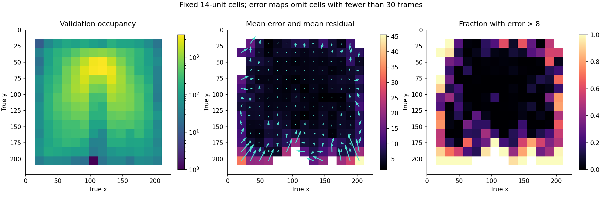

# Experiment 23 frozen-decoder audit: spatially uneven errors

Kaggle `hassanakaou/lewm-decoder-audit`, version 1, completed on 2026-10-13.
This is an exploratory diagnosis after the failed feasibility gate, not a new
confirmatory experiment. The decoder, validation split and input hashes are
unchanged. No model was fitted and no planning evaluation was run.

The CPU job recomputed predictions on all 89,618 validation frames and the
original 300,000 training frames. It reproduced the original median and R²;
the p95 differs by less than 0.000001 native units. Local float64 recomputation
from the saved predictions gives p95 8.97661019. The original limit remains 8.

| Frozen validation measure | Result |
| --- | ---: |
| Median / p95 / p99 error | 3.339 / 8.977 / 16.265 |
| Maximum error | 86.424 |
| Error >8 | 6,461 / 89,618 (7.209%) |
| Error >16 | 924 / 89,618 (1.031%) |
| Episodes containing at least one error >8 | 889 / 969 |
| RMSE, x / y | 2.532 / 4.556 |

## Where the errors occur

| Region fixed before the audit | Frames | Error >8 | p95 error |
| --- | ---: | ---: | ---: |
| Within 28 units of a canvas edge | 3,119 | 52.93% | 28.140 |
| Remaining interior | 86,499 | 5.56% | 8.207 |
| Top half (y <112) | 68,695 | 4.16% | 7.669 |
| Bottom half (y >=112) | 20,923 | 17.22% | 14.090 |
| Within 32 units of the door center | 31,751 | 2.50% | 7.078 |

The outer band contains 3.48% of frames, 25.55% of errors above 8 and 73.81%
of errors above 16. The map shows large inward displacements at several edges,
especially at the bottom. The door center is (112,49) in every validation
observation, consistent with the inspected images. These are spatial
associations; they do not identify the cause in the encoder, decoder recipe,
regularization or training coverage.

Removing the outer band would still leave a p95 above 8. No observations are
removed from the actual feasibility criterion. Nor can the tail be attributed
to a few bad episodes: the ten episodes with the largest counts contribute
5.46% of tail frames, while accounting for 1.12% of all validation frames.
Episode-equal weighting gives 7.108% above 8, versus 7.209% for frame weighting.

## Images, time and data sanity checks

The four image panels preserve the selection rules specified before the audit:
distinct-episode extremes, extremes in each occupied 4×4 spatial bin, random
tail observations and random validation observations. There are 60 unique raw
images. Inspection confirms a visible red agent, with labels centered on it.
The red-excess centroid differs from the label by median 0.238, p95 0.685 and
maximum 0.770 native units. This sampled check argues against a large label/image
offset in these examples; it is not exhaustive validation of all cached images.

All 16 selected distinct-episode extremes occur at step 0 and near an outer
edge. Their predicted positions are displaced into the interior. The eight
extreme-episode traces show errors falling after the initial frames, sometimes
with later excursions. These deliberately selected extremes are not random.

**Post-hoc temporal summaries, added after viewing those images:** step 0 has
969 frames, p95 30.971 and 34.57% above 8. The remaining 88,649 frames still
have p95 8.823 and 6.91% above 8. Steps 10 onward have p95 8.082 and 5.23%
above 8. These summaries do not justify excluding initial frames or changing
the gate, and temporal position is confounded with spatial occupancy.

The modulo-14 plot shows signed-y bias varying with patch phase (roughly
-1.04 to +0.85 units), with smaller signed-x variation. This unadjusted
association does not establish a patch-boundary mechanism.

## Interpretation and next proposal

Training p95 is 9.014 and validation p95 is 8.977; error rates above 8 are
7.304% and 7.209%. Similar aggregate errors in both partitions make a simple
train/validation generalization gap a poor description of this failure. They
do not distinguish representation limitations from an inadequate affine
readout, regularization or uneven spatial coverage.

The next useful step for the decoded-position objective is a **separate decoder
development protocol**, with explicit reporting of edge and initial-state
errors. A small nonlinear readout compared with an affine reference is a
reasonable candidate, not an established solution. Fix the recipe and
acceptance rules before testing on independent, previously uninspected
episodes; the present validation set is now development evidence. Keep the
planning episode exclusions and test the behavior on predicted embeddings
before any later objective comparison. No such fit or new run is launched
by this audit. Experiment 23 version 1 remains stopped, and experiment 22 is
still a separate unexecuted draft.

## Reproduction and provenance

`version1/` contains the 77 returned output files plus the Kaggle log, including
the raw 60 images, residuals, tables, plots and submitted source.
`submission_v1.json` retains the earlier submission record.
`retrieval_v1.json` records completion and all output hashes.
`verification_v1.json` records local checks and the explicitly post-hoc summaries.

Run `python tools/verify_exp23_decoder_audit.py` to verify saved predictions,
metrics, selected pixels, frozen source/input manifests and exact validation
indices. Full private-cache decoding and dataset byte checks were done in the
Kaggle job; the local check does not repeat them. Frames within episodes are
dependent; no independent-frame significance test is reported.

The results and Git history were published on 2026-10-13 after the initial
integration write denial; see the [publication record](../../../docs/exp23_publication.md).
The original submission records and frozen source files are preserved.
